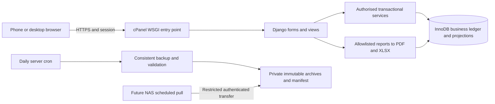

# ADR-001: transactional Python web replacement

Status: initial proposal **blocked for the supplied HostGator Python 3.9.25 / Percona 5.7 target**; not a selected deployable stack. Date: 23 October 2026. See [updated hosting decision](runtime-hosting.md).

## Decision

Use one Django 5.2 LTS application on supported Python 3.12, with MariaDB/MySQL InnoDB and the official Django MySQL backend through mysqlclient. Use the latest supported patches when locking implementation dependencies. Django supplies authentication, password hashing, sessions, CSRF, forms, migrations, ORM and WSGI; business rules live in explicit transactional services, not model signals, templates or unrestricted Django admin edits.

This initial recommendation requires a different runtime/database capability than the owner has now reported. Python 3.9 and MySQL 5.7 are both below Django 5.2's supported minimums. An owner-specified MySQL 5.7 compatibility target cannot be satisfied by disabling backend checks or selecting expired Django. If that target is retained, revise this ADR to a verified Flask/SQLAlchemy-style stack with explicit auth/session/CSRF and migration choices, while resolving the runtime maintenance prerequisite. No such revision is silently selected or implemented in this preparation task.

The browser uses server-rendered responsive HTML/CSS with small same-origin JavaScript for scans/lookups, import preview, report configuration and submission recovery. Serve static assets directly; no Node server, Docker, root access, task broker, persistent worker, WebSocket or native phone app is required in production. Local browser automation/build tooling may use Node without making it a hosting dependency. Self-host assets to avoid unnecessary CDN availability requirements.

Use ReportLab's paginated tables for PDF and openpyxl for XLSX structured import/export, plus defusedxml and bounded ZIP/XML parsing. This avoids requiring a headless browser or OS-level PDF renderer on shared hosting. Spreadsheet imports reject macros, unexpected archive entries, formulas as business values, oversized expansion, invalid dates and unbounded rows; exported text is written as text and protected against formula injection. No photo/document upload storage is added. Controlled restore archives are a separate admin-only maintenance path.

MariaDB 10.11/11.4 LTS is the preferred database target; maintained MySQL 8.4 is an alternative requiring its own CI job before support is claimed. Framework minimums (MariaDB 10.5 / MySQL 8.0.11) are not a recommendation to use an end-of-life database. Select one actual production engine first and run acceptance/concurrency against that exact major version. SQLite is not acceptance evidence for locks, decimals or constraints.

## Components and boundaries

Future package boundaries: `accounts`, `properties`, `animals`, `mobs`, `inventory`, `activities`, `corrections`, `reports`, `audit`, `recovery`, `operations`. Put all state mutations through services with one transaction covering stock, participants, money allocations, restrictions, history, audit and idempotency outcome. No browser SQL, executable report SQL or unreviewed raw model administration. Keep configuration, WSGI adapter, static paths, cron and backup transfer isolated from domain code.

Fresh installation is empty. Create the first admin only with an authenticated maintenance command, no public signup or default password. Two roles, administrator and standard user. Everyone may read financials and perform the specified operational actions; only admin handles sales/deaths reversal, old corrections, historical mob administration, conflicts and purge. Desktop administration is an explicitly authorised route/workflow, not a viewport check. Custom authenticated admin screens must enforce the same service permissions and logs.

Security baseline: HTTPS, secure/HttpOnly/SameSite cookies, CSRF for unsafe requests, password hashing via maintained Django hashers, account disablement/session expiry, login throttling, least-privilege DB/transfer accounts, parameterised ORM, allowlisted filters and protected backups outside the web root. Store deployment secrets in private host configuration; no values in Git, browser storage or logs. Admin-created accounts and password resets do not require SMTP. Users' display timezone/date format are settings; timestamps remain Unix seconds.

## History, arithmetic and recovery

Use an append-preserving event/transaction ledger with current projections and dated historical relationships, not full event sourcing. Every animal has a permanent identity independent of tags and presence cycles. Store effective time separately from recorded time and deterministic same-second order; retain participants and price basis on each accepted event. [Database design](database-design.md) specifies precision, residual allocation, locks, temporal checks and correction previews.

Pending recovery is browser-local input, not offline business state or an ordinary draft feature. Associate pending payloads with authenticated account/installation; purge or isolate access on logout/account switching, do not keep authentication tokens in payload storage, and explain shared-device/browser-clear limitations. On network uncertainty show “not confirmed”, retain through reload, offer readable text download/share, review/retry/discard. The database owns an immutable idempotency result. On retry, return a committed result before revalidating as a new event; never reapply it. Only an uncommitted request is revalidated; material changes require review. Local discard cannot undo a committed event. Live server data is never replaced with a browser cache.

## Hosting and operational fit

Use cPanel's Python application mechanism only after its actual interpreter, WSGI/Passenger integration and shared libraries are verified. No deployment performed. A plan limited to Python 3.9 requires a runtime upgrade or a different plan/host; do not pin expired Django 4.2 to fit it. A Flask release advertising Python 3.9 compatibility does not restore CPython security support. See [evidence and preflight](runtime-hosting.md).

Owner-supplied evidence now identifies HostGator Hatchling shared hosting, Passenger Application Manager, Python 3.9.25, Percona 5.7.44-48, working SSH/cron and mysqldump. Python/WSGI application support and SFTP remain explicitly unconfirmed. Passenger's presence does not prove that this account can register/run a Python WSGI application. MySQL 5.7 also lacks enforced CHECK constraints: the logical schema's format/balance checks need a proved alternative (for example authorised triggers), not declarations the server ignores. Unique indexes, foreign keys and row locking still require InnoDB verification on the actual engine.

Use bounded synchronous reports for the initial 1–10 accounts. For larger exports, use a DB job record processed by scheduled cron if proven necessary; do not require a persistent worker. Measure host request time/memory before adopting this fallback. Daily cron creates self-contained consistent archives and retains the three latest successful unique versions; NAS pull is a later, explicitly bounded task. Backups and restore details are designed in [database design](database-design.md), not executed here.

## Alternatives and review points

Flask with SQLAlchemy/Alembic is viable on a supported Python runtime but introduces additional choices for account management, CSRF, admin and migrations. It is not chosen merely to accommodate end-of-life Python. Django's batteries reduce the security/maintenance surface for this size of application. A SPA/API split adds build and recovery complexity without a stated need. Legacy PyQt/SQLite, identifier primary keys, mutable cost totals and a standalone JSON merge process do not meet the agreed history and concurrency rules.

Proposed technical policies for review: calendar-day restriction arithmetic in the property timezone; exact decimal allocations with deterministic residual handling; actual effective-time stock checks plus protection of later accepted events; typed declaration/signer fields without claiming cryptographic signatures; retention tombstones preserving nonreuse/shared totals. These are explicit implementation choices, not new fixture assumptions. Initial delivery has no weights, maps, paddock-management UI, attachment storage, NLIS service integration or automatic purging.
