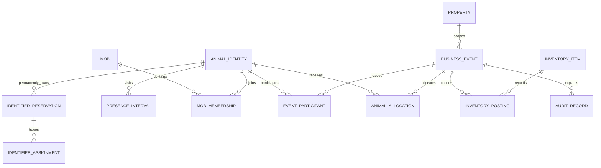

# Database design: identities, history, allocations and operations

Status: proposed logical schema and invariants, not implemented DDL/migrations. Every table below is new; there is no legacy import. Target one proven MariaDB/MySQL InnoDB version, strict SQL mode, utf8mb4, enforced foreign keys and checks. Exact DDL/index portability must be tested on that engine in stage one.

**Hosting update:** the owner now requires MySQL 5.7 compatibility and reports Percona 5.7.44-48. The initial Django mapping is incompatible with that target. MySQL 5.7 parses CHECK declarations without enforcing them, so every database-level invariant described below requires a documented implementation on that engine (e.g. BEFORE INSERT/UPDATE triggers with SIGNAL and sufficient grants). Do not claim these checks exist merely because a migration emits CHECK SQL. Unique/FK constraints and transactional InnoDB locks remain applicable, but trigger creation, dump inclusion/restore, temporal rules and direct-invalid-write rejection must be proved against Percona 5.7 before accepting this design. If necessary grants or enforcement mechanisms are unavailable, that is a genuine blocker to the current database-invariant proposal; do not silently weaken the agreed rules.

Django-specific references below (`transaction.atomic()`, Django account models and model fields) describe the initial, now-blocked framework mapping. The logical identities, ledger, exact arithmetic, permissions and temporal invariants remain requirements for any revised backend. A Flask/SQLAlchemy path must explicitly replace those framework adapters with equivalent tested transaction/auth/migration components; the references are not a claim that Django can run on 5.7.

## Types, scope and time

- Stable business identity keys are UUIDs stored as canonical strings initially; internal row IDs may be BIGINT. No financial identity depends on a replaceable tag. References to purged animals can retain an opaque identity tombstone without their descriptive record.
- Tenant-owned rows carry `property_id`; initial install has one property/PIC. Queries and services enforce property scope, with composite unique/FK constraints where supported by the migration strategy. Global identity reservations are installation-wide so changing property does not enable reuse. Multi-PIC switching is not built now.
- Quantities and allocation amounts use `DECIMAL(30,12)`; conversion factors/unit rates use `DECIMAL(38,18)`. Python `Decimal` context precision >=60; parse from decimal strings, never float. Validate numeric bounds and representability, reject unsupported precision rather than silently truncating. AUD only initially. Zero is a value; NULL purchase amount means unknown.
- Business timestamps are signed BIGINT Unix seconds: `effective_at`, `recorded_at`, and where applicable `submitted_at`. Distinguish a server-confirmed submission time (the 24-hour clock) from optional client timestamps. Equipment/expiry/DOM date-only fields are DATE with explicit date kind; do not invent a time of day for them. User timezone and format govern rendering; property timezone governs business calendar-day calculations. Use Python zoneinfo, avoiding reliance on global MySQL timezone-table installation.
- Persist `effective_order` for intentional sequencing at the same Unix second and a unique monotonic recorded sequence for audit. Resolve ambiguous daylight-saving times using explicit offset/fold input; reject nonexistent local times. Do not silently use receipt order to override known event order. Membership/presence intervals are half-open in `(effective_at, effective_order)` space.
- Proposed restriction rule for review: add the combined restriction's number of local calendar days to the treatment effective instant in the property timezone, retain the resulting Unix timestamp, and take the maximum of applicable treatments. Define exact safe-at boundary in UI/tests; zero days means no additional interval. Persist rule version/timezone with the restriction so settings changes never silently recalculate history. This interpretation is an explicit design proposal; the specification fixes the days field and maximum rule, but not DST boundary arithmetic.

Equal allocation: calculate exact event total first from the preserved cost basis. Split into integer 10^-12 quanta; give each participant the quotient and distribute remaining quanta by ascending permanent identity. This preserves the exact total with a deterministic difference of at most one quantum for indivisible splits. Never round each dose to cents. Store total, participant count, cost basis, allocation rule version and allocated amounts. Quantity allocation uses the same rule where per-animal quantities are materialised. A 20 L/$250 receipt has $12.50/L and $0.0125/mL, not a rounded cent per mL.

Display uses decimal half-up to AUD cents. For grouped financial tables whose line totals must add to the shown grand total, distribute display-only cent residuals deterministically using largest remainder and stable identity tie-break; label this policy and provide full-precision values in export detail. Do not alter ledger allocations for display rounding. Exports distinguish unknown cost/incomplete P/L from numeric zero and show report selection semantics.

## Entity groups and key fields

All business rows have creator/recorded time as appropriate; changes link to an event and an audit row. FKs use RESTRICT/protected deletion for ledgers, not broad cascades. Names below are design vocabulary shared with the LPA matrix; implementation may use normalised child tables without dropping fields.

| Entity | Important fields and constraints |
|---|---|
| `property` | UUID, PIC, name, timezone, currency=AUD, settings version, mutation/version guard. Single seeded property, no switching UI. PIC preserved as string. |
| `account`, `property_account`, `user_setting` | Django user with hashed password, enabled status; scoped role `admin`/`standard`; display timezone/date format. Protect last active admin; authenticated first-admin maintenance setup. Session invalidation on disable/reset. |
| `animal_identity` | Permanent UUID, property/installation lineage, optional purged/tombstone status. No temporary newborn identities before a tag. |
| `animal` | Identity FK, current projection of lifecycle/breed/sex/DOB or estimated-age-weeks and reference date, completeness flags. Attribute history is separate. Current status is a projection, not the source of past membership. |
| `identifier_reservation` | Kind `NLIS_VISUAL`/`RFID`, canonical value, identity FK/tombstone, first-reserved event/time; unique `(kind, value)` across all lifecycle states and all assignment history. Never delete or transfer to another identity. |
| `identifier_assignment` | Reservation, identity, effective start/end/order, current/retired flag, replacement/correction event. Same identifier may be reactivated only for its original identity after authorised correction. Separate current slot `(animal_identity, kind)` prevents two simultaneous current tags of one kind. |
| `animal_attribute_change` | Identity, field, previous/new typed value, effective time/order, event, recorded time; includes breed, sex/castration, DOB/age reference and other corrections. Reports can select current/as-of values. |
| `lifecycle_event`, `arrival`, `departure`, `arrival_animal`, `departure_animal` | Common event plus per-animal links; source `purchase`/`birth`/`repurchase`; arrival time, source PIC/NVD/NLIS upload reference, vendor name/address, destination-paddock text and notes. Exit kind `sale`/`death`, destination PIC/name, NVD/upload reference, reason, explicit per-head/group price and preserved allocations. Mother identity/reserved NLIS required for birth. Purchase amount nullable; farm-born explicit zero. |
| `presence_interval` | Identity/property, arrival event, start instant/order, departure event/end instant/order; no overlap for the same identity. Repurchase opens new interval on the same identity. Death closes interval; admin correction needed to reopen after a death. |
| `mob`, `mob_membership` | Scoped mob name/status; identity, mob, effective interval/orders, opening/closing event. Zero or one concurrent mob per animal, only during presence. Retain all superseded interval versions when corrected. |
| `business_event`, `event_participant` | UUID, type, property, effective/recorded/submitted timestamps/orders, submitting user, responsible/performing person snapshots, reason, original/reversal/correction links, rule version and causal version; participants are permanent identity snapshots with historical tags/mob/presence references. No phantom current-headcount allocation. |
| `inventory_item`, `inventory_receipt` | Item type feed/chemical, product/category/type, stock unit, dose unit, conversion factors, package size, unit price, retirement flag, immutable matching signature. Receipts retain quantity, unit size/value, source/supplier, effective receipt date, declaration/test/storage/signer details, batch and date kind/value as relevant. Identical-price/spec receipts add to a selectable item with separate receipt rows. Different price/package/conversion or chemical batch/date requires separate item. |
| `inventory_balance`, `inventory_posting` | Item/property current quantity/value projection and version; append-preserving receipt/consumption/adjustment/reversal postings with quantity, cost basis, event, effective/recorded time. Feed can be negative; chemical nonnegative CHECK on balance plus service temporal validation. Retirement hides future selection, never deletes links. |
| `stocktake` | Item, measured actual balance, prior balance, delta, mandatory reason, responsible account, event. Adjustment changes inventory only; cannot rewrite animal expense allocations. |
| `feed_event` | Event, one mob, selected item, input mode (`fractional_bales`, `total_kg`, `kg_per_head`, configurable compatible unit), actual quantity/unit, conversion/headcount snapshot, derived total kg/cost, storage/responsible-person snapshot, optional linked LPA report grouping. All consumption treated as consumed, no wastage allocation. |
| `treatment_event`, `treatment_animal_detail` | Event, one identity or entire historical mob, chemical item optional only for procedures, actual dose/head and unit, actual total, performing person name/contact, combined restriction days, product/batch/expiry snapshots, explicit expired-use override/reason, description/location, administration method/rate description, adverse reaction, broken-needle tri-state/details, equipment cleaned/calibrated tri-state/date and person/contact. Per-animal detail supports reactions or needles affecting fewer than all treated animals; preserve treatment-wide and individual fields. No weight-based dosing or treatment draft state. |
| `illness_observation`, `procedure_event`, `restriction` | Dated clinical note with no automatic charge; procedure type, optional per-head/group fee, performing vet/person, no product required. Castration links a sex history change. Per-animal restriction start/end/rule version links to actual treatment and remains through tag/mob changes. Departures record warning/acceptance and actor even though permitted. |
| `financial_posting`, `animal_allocation` | Event, category purchase/sale/feed/chemical/procedure/vet, source total, AUD, optional incomplete-price marker; one deterministic allocation per event/category/participant and reversal reference. Expense/revenue directions explicit. Unique source keys prohibit duplicate posting. No transport/agent/levy/unrelated fees. |
| `submission` | Unique `(property_id, account_id, idempotency_key)`, canonical request digest, operation, status, committed event/result pointer, server submission time, payload/result retention policy. A changed payload under the same key conflicts; an already committed request returns its original outcome. Never expire committed keys in a way that permits a second execution. |
| `import_batch`, `import_row` | Account/property, source type, column mapping/shared values, validated preview/version/digest, row errors, confirmed selection and event links. Temporary uploaded bytes are bounded and removed after processing; not general attachment storage. Atomic confirm commits all explicitly selected valid rows or none, with excluded rows clearly listed before confirmation; never silent partial import. Revalidate uniqueness at commit. |
| `audit_record`, `correction_preview` | Actor, property, action, original event, before/after effects, reason, recorded/effective time, request reference, warning acceptance. Preview includes dependent events and causal versions; reject stale preview and re-review. No secret/plain password values. Normal users cannot edit/delete audit records. |
| `report_template`, `report_template_revision`, `report_run` | Shared name, versioned allowlisted field/filter/group/sort definitions and changes; account/property, selection semantics (`current`, `as_of`, activity dates, presence interval), full-lifetime financial rule, generation time and reconciliation metadata. Any account may create/edit/delete templates, always audited and scoped. |
| `backup_manifest`, `restore_run`, `purge_run` | Immutable archive identity/hash/schema/app/dependency version/created time/status/path, validation and rotation evidence; restore target/compatibility/maintenance status and audit; deliberate retention eligibility/as-of/preview/confirmation, tombstones and aggregate reconciliation. Never persist secret values in these logs. |

Future extension points, no initial interface: `animal_weight(identity, measured_at, kg, source_event)` added by a future migration; `paddock`/geometry and dated occupancy referencing identities and multiple mobs; property-scoped foreign keys already permit future multi-PIC work. Initial LPA location/paddock fields are plain structured text snapshots, not a map/paddock-management module.

## Database-enforced invariants versus locked service rules

Enforce FKs, non-null required fields, positive conversion/package factors, supported enumerations, identifier uniqueness/length, RFID exactly 15 ASCII digits, visual ID exactly 16 characters, nonnegative chemical balance, unique submission keys and unique allocation source tuples in SQL as well as validation. Preserve leading zeros in strings. Canonicalisation policy: trim input wrappers, use canonical uppercase visual IDs (retain submitted spelling in import/audit); do not silently remove characters. Database check expressions and collation must be verified on the chosen engine, including direct invalid inserts. Identifiers use a deterministic binary collation consistent with canonical values, not a locale-dependent comparison.

SQL cannot portably enforce arbitrary overlapping temporal intervals or dynamic permission rules across both database families. Every mutation therefore first locks the property's single mutation-guard row, then affected animal identity rows and inventory rows in stable key order. This deliberately serialises writes for the initial 1–10-account property, preventing membership/feeding races as well as overspend. Indexed property/identity/item lookups avoid accidental full-table locking. Revisit granularity only with tests. Read-only reports use a consistent snapshot; they cannot write projections.

Inside `transaction.atomic()` on READ COMMITTED: resolve and authorise the request, acquire guard/row locks, check or create the idempotency record, validate effective-time presence/membership and stock, create the event/participants/postings/restrictions/history, update projections, append audit, store committed result, then commit. A committed idempotency result is returned even if current stock/roles/history have changed, subject to current read authorisation. If permission is revoked, do not re-execute; give a safe status result. On unique-key contention or retryable deadlock, roll back and safely reread/retry the complete operation, with bounded retries. No warning dialog, file transfer or human interaction occurs while holding a transaction open.

Feed: require starting balance >0 before acceptance; one event may cross below zero and charges its full actual consumption. Subsequent events at zero/negative fail. Replenishment is inventory only, never another animal expense. Chemicals: total actual dose times frozen participant count must be available; insufficient quantity rejects the entire transaction without allocations. Never reduce/recommend a dose. Lock and check before writing, not only when populating a dropdown. Expiry override and departure restriction acceptance are explicit request fields recorded with actor/reason; DOM is never treated as expiry.

For normal backdated feed/treatment, resolve members from historical presence and membership; require the selected lot to have existed and been received by then. Proposed conservative chronology policy: validate the new effective-time stock timeline against all later accepted postings; also retain the current nonpositive-feed prohibition. Refuse changes invalidating later starting-balance or chemical limits and offer an explicit correction review. Preserve old participant lists, conversion factors and prices; do not silently replay/reprice them. This stock chronology policy is a design choice for review, not permission to forbid ordinary valid backdated feeding/treatment. Test it explicitly with later receipts and conflicting events.

Arrival/sale/death: require per-animal identifiers and required movement fields, close presence/membership atomically on exit and prevent subsequent ordinary cost accumulation while off-property/dead. Sales support exact per-head or group-total allocation; deaths require reason and zero income without sale destination/NVD. Repurchase reopens the same identity, adds new purchase cost and preserves all sale income. Birth is explicit zero purchase and requires mother's NLIS; reserve/trace mother identity if known but do not invent a pre-tag animal. Minimum imports missing price/breed/sex/mob/age show incomplete fields without fabricated defaults.

## Reversal, correction and reporting

Standard users may reverse only their own eligible non-sale/non-death actions strictly before `submitted_at + 86400` seconds, using server submission time. At the boundary or later, admin is required. Sale/death reversals always require admin. Admin-only historical mob correction uses an explicit administration workflow at any screen size. Preview affected balances, allocations, restrictions, identifiers and downstream events; apply compensating postings and versioned intervals in one transaction. Preserve original records; do not silently reverse an arbitrary subset of a group or silently release an identifier. Refuse stale/conflicting previews until a coherent correction is confirmed.

P/L derives from all lifetime allocations for selected permanent identities: sale revenue minus purchase/feed/chemical/procedure/vet costs. Unknown purchase prices mark P/L incomplete rather than zero; known zero birth is complete. Active animals show costs/revenue to date and status, not a final realised-sale result. Report selection date/presence filters select animals, never truncate their financial lifetime. Historical mobs include former members and deaths when the query asks for original membership, with a separate survivor-only filter. Keep unknown prices and rounding policy visible in PDF/XLSX, and reconcile allocations to inventory/event/audit totals.

## Backup, restore and deliberate purge design

Daily cron acquires an installation backup/schema-change guard. Use a supported transactional DB export (e.g. compatible dump with `--single-transaction`) while excluding migrations/DDL. Include all InnoDB tables and required metadata consistently; never raw-copy live database files. Package accounts/password hashes, business/audit/history, settings/templates, app/schema version, exact source release material or reproducible source reference, dependency lock and checksums. Do not assume a local-only Git SHA is retrievable elsewhere; include release source if that cannot be proved. Backups live outside the web root, access restricted; encryption/recovery key custody must be documented and tested with the owner before operation.

Write archive and manifest to temporary paths, validate contents/checksums, atomically publish an immutable unique filename, update authenticated “latest completed” discovery, then retain exactly the latest three successful unique archives (once three exist). Failures do not rotate good versions. Discovery returns immutable ID, length and SHA-256, never a changing slot path. An authenticated transfer pins that ID for the download and prevents deletion while in use, or fails safely with retry if rotated; never serves mixed bytes. No public backup URL or secrets in scripts.

Future NAS Python pull: restricted SFTP/SSH key or narrowly authenticated HTTPS, verified host key/TLS, discover completed ID, download to temporary path, verify hash/size/completion, publish atomically, retain three latest successful unique versions, deduplicate retries, log failure without deleting good copies. Schedule/timezone must be explicit on both machines. This task neither implements nor runs the pull and never connects to NAS.

Admin maintenance restore: explicit empty/disposable target confirmation, maintenance mode and lock, bounded safe archive extraction (no traversal/symlink escape), checksums, schema/app compatibility and environment-specific credentials/key preflight. Restore to isolated target, validate all data/account/stock/allocation/audit/template totals before switching; failure leaves the previous target intact or documents rollback from a pre-restore backup. Test compatible versions and forward migrations; do not promise arbitrary future-version restore.

Retention defaults to indefinite with no automatic purge. Admin preview permits detailed animal deletion only when currently off-property/dead and at least ten local calendar years from latest exit/death; repurchase resets eligibility. A transaction's own age is irrelevant. Proposed preservation policy: redact/delete eligible descriptive data and identifying snapshots, retain minimal permanent identifier reservations tied to an opaque tombstone, and retain anonymised shared-event participant allocation amounts and aggregate accounting/audit references needed for unrelated animals' reconciliation. Redact related import/submission cached payloads too; do not blindly cascade shared records. Log who authorised purge, eligibility cutoff and reconciliation outcome. No promise of irreversible erasure from older backups: copies retain old records until normal rotation. This boundary between detail removal and retained nonreuse/accounting tombstones must be documented in owner-facing purge preview.
