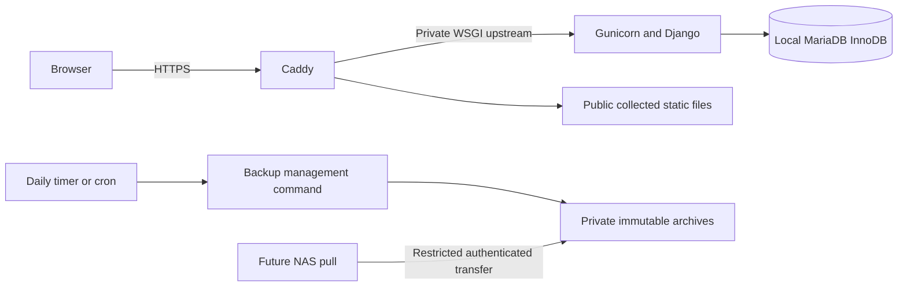

# RackNerd VPS deployment and resource plan

Proposal only, updated 23 October 2026. Target: RackNerd KVM, 2 GB RAM / 35 GB SSD / 2 vCPU. Prefer minimal Debian 13; Ubuntu 24.04 is an alternative. No commands here have been executed on a VPS and no live data/NAS has been accessed.

## Runtime layout

Caddy serves the public domain and public static files only. Gunicorn binds to loopback or a permission-controlled Unix socket, never a public listening interface. MariaDB is local/private. Application, database and web server use separate least-privilege service accounts; application code and backup archives are outside the public static root. Authenticated backup download routes must authorise each request, not expose archive directories through Caddy's file server. No directory browser is enabled.

Use signed OS packages and a supported signed Caddy package source, plus hash-locked application dependencies in a virtualenv. Do not disable TLS, apt signatures or artifact verification. Configure the distribution interpreter rather than replacing `/usr/bin/python3`. Provisioning may use admin privileges when separately authorised; Gunicorn never runs as root. Production has no Django development server or DEBUG pages.

## Starting memory/concurrency configuration

- Gunicorn: **one worker, two threads**, then measure. Do not use an automatic `2 × cores + 1` formula on 2 GB RAM.
- MariaDB: start with **256–384 MiB InnoDB buffer pool**, a conservative connection limit and measured query/temp-table settings. Buffer pool is only part of DB process memory; account for connection buffers and exports.
- Bound import rows, ZIP expansion, export page size and request duration. Stream or use openpyxl write-only export where suitable, preserving exact decimal/report semantics. Read-only import remains validated and resource-limited.
- Schedule heavy backup/restore work apart from report bursts; run at most one heavy export if measurements show parallel requests exhaust memory. Use a bounded management command under cron/timer for long maintenance jobs rather than adding a persistent queue worker by default.
- Leave operating-system/page-cache and peak-operation headroom. Optional modest swap is emergency protection, not normal operating memory. Collect actual peak RSS, swap/OOM events, DB latency and report duration in staging. No resource measurements have been made yet.

The application guard/row-lock design still serialises conflicting inventory/membership mutations correctly. Low worker counts do not replace database concurrency tests: test two independent sessions against real MariaDB.

## Disk and backup budget

35 GB advertised capacity is about 32.6 GiB before partition/filesystem overhead. Check actual usable space before setting quotas. Illustrative planning ceilings, not measured usage:

| Use | Initial budget |
|---|---:|
| Minimal OS and system packages | 6 GiB |
| App virtualenvs, releases and static assets | 2 GiB |
| Database including indexes and ordinary growth | 5 GiB |
| Bounded logs | 1 GiB |
| Optional swap | 1 GiB |
| Backup archives and temporary workspace | 10 GiB |
| Free headroom | 5 GiB |
| Total | 30 GiB |

These are capacity-planning allocations, not a promise that a 5 GiB live database and all backup/restore operations fit in 10 GiB. Measure compressed archive size and dump/workspace usage. Before backup publication allow for **three existing good archives + a complete new candidate + database export/work files + headroom**. Restore validation may need an additional isolated database/release/workspace; use an isolated test machine when safe local space cannot be proved. Do not assume a favourable compression ratio or remove old good archives merely to make the next backup fit.

Follow the agreed sequence: write temporary candidate, validate checksums/completeness, atomically publish immutable archive/manifest, then rotate to the three latest successful unique versions. On low space/failure keep existing good versions, record the failure and surface the required action. Bound journal/Caddy/app/database logs and retain only needed release artifacts. Monitor database/binlog growth explicitly; do not disable necessary durability or silently purge business/audit records to free space. Offsite NAS copies are still required by the specification; VPS/provider snapshots are supplementary, not substitutes for tested StockLOG restore archives.

## Caddy and Django configuration to verify later

Use a real domain resolving to the VPS; ensure valid IPv4/IPv6 DNS and firewall rules before ACME issuance. Caddy handles certificate renewal and HTTP-to-HTTPS redirection under a persistent supervised service. Retain its writable certificate state securely. Start with TCP 80/443 public and restricted SSH administration; UDP 443 is optional for HTTP/3, not required for core HTTPS. Do not expose Gunicorn or MariaDB publicly.

Route the public static prefix to collected static files, with application requests going to Gunicorn. Static files are public application assets, not reports, imports, backup files or user records. Configure Django `ALLOWED_HOSTS`, trusted CSRF origins, secure cookies and proxy HTTPS interpretation for the exact domain. Trust forwarded headers only from the controlled local proxy, prevent direct external Gunicorn access, and verify correct secure redirects/client identity without loops. Any upstream CDN changes the trusted-proxy design and requires a separate check.

Caddy is a web server/reverse proxy, not a graphical hosting administration interface. Routine administration remains SSH/systemd plus the application's authorised administration screens. No cPanel/Passenger installation is needed.

## Later deployment acceptance gates

1. Select OS, provision current signed updates, verify admin access, storage/memory and domain. No purchase or provisioning is performed in this task.
2. Install the reviewed application release with exact dependency locks and tested migrations into a fresh empty database. No legacy-data migration.
3. Validate Caddy/Gunicorn/systemd, HTTPS/static routing, authenticated requests, CSRF, permissions and process restart; measure fixture and report memory under concurrent requests.
4. Generate three successful archives, test interrupted/failing publication and disk pressure without losing good copies; prove immutable discovery and authenticated transfer.
5. Restore a generated archive into an empty isolated installation and independently compare accounts, settings, templates, identities, audit, balances and allocations. Choose an adequately sized isolated target rather than risking the production disk.
6. Implement/document NAS scheduled pull later; obtain any needed connection authorisation separately. Publish only after the owner explicitly authorises deployment.

All original animal/finance/LPA/correction/retention/recovery rules and scenario totals remain unchanged. VPS sizing affects operational limits and test planning, never silent partial transactions or relaxed financial/history rules.
